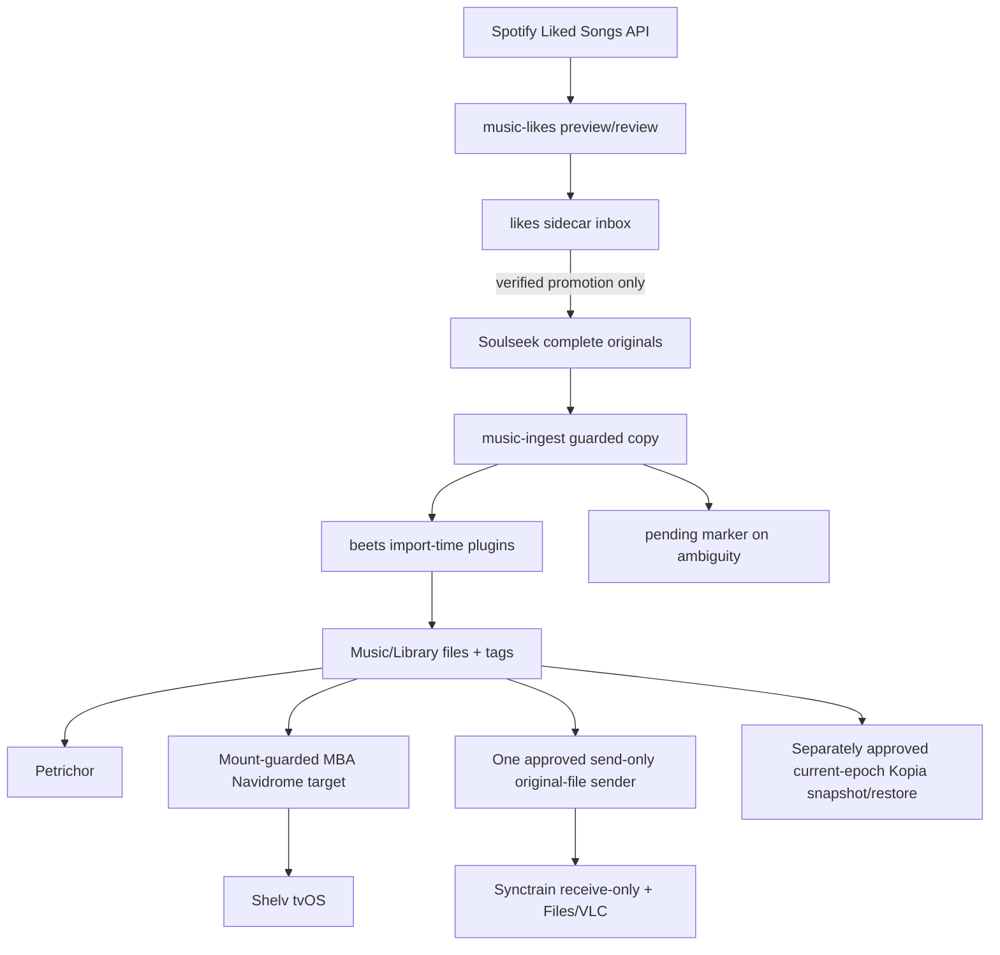

**SSOT:** audio files under `$HOME/Music/Library` plus embedded tags. beets and Navidrome also retain catalog, user and history state that must be recovered alongside the files. Do not point players at `$HOME/Music` (Serato/DAW trees live there).

```bash
just check-music-ingest
just check-music-likes
just check-mba-migration-policy
just music-ingest              # doctor; source-only view
just music-likes               # doctor; source-only view
just music-ingest ingest --dry-run
just music-ingest refine --dry-run
just music-ingest catalog --dry-run
just music-ingest enrich --dry-run
just music-likes sync --dry-run
just music-ingest-install --dry-run
just music-likes-install --dry-run
```

The `--apply` paths write files, databases or installed jobs and require the applicable backup, writer and exact-action gates. Whole-library `catalog --apply` and `enrich --apply` are **disabled** in the current repo source; a dry-run is not authority to enable them. On the named MBP/MBA accounts, both legacy music service installers now refuse before copying, rendering or enabling jobs. Use the existing MBA contract installer for guarded reader/writer activation; manual rollback uses retained plists.

`just music-ingest` is doctor. In the current **repo source**, `ingest --dry-run` previews settled Soulseek `complete/` audio; apply uses a cooperative shared writer lock, validates candidates, imports with beets `--copy`, checks newly observed IDs/Library paths and **retains inbox originals**. A failed or ambiguous import retains a pending marker and blocks subsequent cooperating writes until attended reconciliation. It does not run a separate post-import enrichment pass. This is not a deployed-runner or content-provenance guarantee: the effective beets config has `quiet_fallback: asis` for unmatched imports, but still enables import-time autotag/write and automatic art/key/chroma hooks. Do not enable unattended MBA ingestion until those effects, all independent writers, backup and a one-item pilot are reviewed. `refine` / `prepare` default to dry-run and fill missing musical key/Camelot/BPM/Open Key only with an approved `--apply`; `catalog` and `enrich` are preview-only. `downloading/` is outside the ingest scope. None of these previews proves a complete backup or authorizes cloud-placeholder hydration.

## Metadata ownership and recovery

| Role | Responsibility |
| --- | --- |
| Audio files + intentional sidecars | Canonical metadata, artwork, and lyrics outputs/SSOT |
| beets | The configured import still enables automatic autotag/write, fetchart/embedart, keyfinder and chroma hooks. These can make network calls and tag/art changes **during** an import despite the runner's disabled post-import enrichment. Import-time effects must be piloted and backup-gated. |
| Picard | Manual metadata review for exceptions; preserve protected tags and use a separately reviewed import. |
| `music-ingest` | Copies settled source audio into the Library, retains originals, and blocks cooperating writers on ambiguous import; it is not a metadata-repair or completed-provenance guarantee. |
| Navidrome | Derived consumer. Embedded/local album art and local/embedded lyrics stay ahead of external fallback; Deezer and ListenBrainz provide no-key external artist data. Last.fm is not configured. The 5-second filesystem watcher is authoritative (`Scanner.Schedule = 0`); run explicit full scans only when needed. |

External queries are a privacy boundary: Cover Art Archive, iTunes/albumart, LRCLIB, Deezer, and ListenBrainz receive artist/title/album/duration or MusicBrainz IDs as applicable. This policy sends no audio or secrets. No Last.fm credentials are configured.

For metadata repair, back up first and validate representative positive and no-result samples before expanding the scope:

```bash
beet fetchart -q 'id:505'   # expected no qualifying >=500px image
beet fetchart -q 'id:1838'  # positive 1200px iTunes sample
beet lyrics 'id:2169'       # positive LRCLIB sample
beet lyrics 'id:1409'       # expected no result, but no crash on 2.14+
```

Verify approved samples in the files, beets and Navidrome only **after** the applicable complete snapshot and isolated restore. Any later narrow backfill requires its own reviewed writer window; `music-ingest enrich --apply` is currently refused, not a repair shortcut. Do not use `--force` or bulk `embedart`; preserve existing artwork and successful partial results.

## Existing library (safe refine)

Do this before any beets path rewrite.

```bash
just music-ingest refine --dry-run
just music-ingest prepare --dry-run
```

Do not follow a preview with `refine --apply` until the canonical Library has a complete, current, non-checkpoint backup and isolated restore and the exact metadata-writing pilot/window is separately approved.

Default roots: `$HOME/Music/Library` and `$HOME/Soulseek Downloads/complete`. Serato/DAW folders under `$HOME/Music` are skipped. iCloud Music placeholders are skipped unless `MUSIC_INGEST_INCLUDE_ICLOUD=1` (still skips dataless files).

| Guard | Effect |
| --- | --- |
| Default `--dry-run` | No writes until `--apply` |
| Occupied `TKEY` | Never replaced (musical note **or** Camelot stored in `TKEY`) |
| Occupied `CAMELOT` | Never replaced |
| Occupied BPM / Open Key | Never replaced |
| Fill-if-missing | Empty `TKEY` gets a note; empty `CAMELOT` gets Camelot; aliases `INITIALKEY`/`KEY` filled independently if missing |
| Mismatch | If note and Camelot already disagree, both are kept |
| Dual write | Musical key and Camelot are both filled when one is known and the other slot is empty |
| TKEY held Camelot | Copied into `CAMELOT` if that frame is empty; `TKEY` left unchanged |
| Dataless / 0-byte | Skipped (will not hydrate iCloud) |
| `_Serato_`, Ableton, Mixxx, … | Skipped |
| `--force-analyze` | Refused |
| Ingest copies | `ingest` uses beets `--copy` and retains `complete/` originals; an unresolved pending marker blocks cooperating writers. Refine does not relocate files or run beets |
| Serato GEOB / `SERATO_*` | Not stripped |
| WAV / AIFF PCM | Skipped (ID3-on-WAV prepends a header and breaks ffmpeg) |

Soulseek Qt places completed transfers under `$HOME/Soulseek Downloads/complete`; `downloading/` remains out of scope. The **source** ingest LaunchAgent watches `complete`, but its installed runner, in-flight children and independent writers must be checked before any handover. The current source waits for settled candidates, uses beets `--copy`, leaves the original inbox files in place, and requires distinct new beets IDs/previously unseen Library paths with source-byte matches and a stable input fingerprint before recording success. Sidecar-only additions, edits or removals are logged as review proposals and do **not** reimport unchanged audio. Changed audio in a previously verified multi-track unit stops for review; an old anonymous seen receipt migrates only on an unchanged all-file hash, which does not by itself prove path-specific import history. This conservative byte gate can reject a real import if beets rewrites tags or embeds art; that leaves a pending marker for review, not permission to retry blindly. A failed/partial import leaves originals and a blocking pending marker for manual reconciliation; even byte/path checks do not prove recording or release identity, and they cannot attest independent beets writers or installed-runner parity. The source does not chain post-import enrichment or delete byte-identical inbox copies. Import-time beets plugins may still tag files or fetch art, so even one manual apply waits for backup/restore and a reviewed pilot. Preview with `just music-ingest ingest --dry-run`; do not infer installed behavior from this repo command.

| Path | Role |
| --- | --- |
| `$HOME/Music/Library` | Canonical library (`$format/Artist/[year - ]Album/disc-track Title.ext`) |
| `$HOME/Music/Library/Incoming/review` | Reviewed exception area; do not move failed source audio here automatically |
| `$HOME/Music/Library/Playlists/Liked Songs.m3u` | Liked Songs mirror in Spotify order (`../`-relative entries); see Liked Songs sync |
| `$HOME/Soulseek Downloads/complete` | Ingest inbox (WatchPaths). Current source **retains** completed originals after `--copy`; neither a nonempty inbox nor a recorded ID count proves an unambiguous Library import. |
| `$HOME/Soulseek Downloads/downloading` | In-flight; do not import |
| `$HOME/.local/share/music-likes` | Likes sync state: `liked.csv`, `missing.csv`, `state.json`, `inbox/` (sockseek sidecar), per-format indexes |
| `rig/home/private_dot_config/beets/config.yaml.tmpl` | beets |
| `rig/home/private_dot_config/navidrome/navidrome.toml.tmpl` | Navidrome |
| `executable_music-ingest` + `executable_music-dj-tag` | Ingest + DJ fill |
| `com.wyattowalsh.music-ingest.plist.tmpl` | WatchPaths on complete |
| `com.wyattowalsh.navidrome.plist.tmpl` | KeepAlive LAN server `:4533` |

### Byte-preserving MBA delivery profile

`rig/bootstrap/music-delivery-profile.py` prepares a separate `BEETSDIR` from
hash-bound qualified consumer, matching publication and accepted operator receipts. It retains their
actual database, canonical destination and path formats; it refuses the default
Music/iCloud root. Copy is enabled, while tag writing, autotagging, moving,
linking, remuxing, plugins and included configuration are disabled. Format and
special-version variants remain distinct. Preparation changes no database or
media and leaves the normal configuration and consumed consumer receipt intact.
A reviewed consumer/writer successor must bind the new profile before use.
`checks/music-delivery-profile-test.py` proves a real disposable FLAC import with
a new ID, effective canonical path, identical complete bytes and retained special
tags/art; that fixture is not a live MBA import or recovery receipt.

## Liked Songs sync

The source `music-likes` pipeline reads the Spotify Liked Songs API (`user-library-read`, no Premium), writes an Exportify-compatible `liked.csv`, matches beets by ISRC/artist/title/duration/mix class, previews `missing.csv` and builds an m3u in Spotify order, preferring extant FLAC > WAVE > AIFF > MP3 > AAC files. A second Soulseek account is intended for missing variants; Qt's account remains separate. This is **not** a completed or unattended backfill: current fetch/provenance and writer gates hold downloaded sidecar files for review.

sockseek writes into a **sidecar inbox** at `~/.local/share/music-likes/inbox`, not directly into `complete/`. The source runner proposes one subdirectory per promoted audio file under `complete/music-likes/<slug>/`; `*.incomplete` remains in the sidecar for later review. A successful subprocess exit alone does **not** prove that every requested song arrived or that a promoted audio-suffixed file is decodable and matched to the intended liked track. Current source refuses `promote --apply` without a reviewed per-row identity/hash/decoder gate; an apparently successful fetch with queued items keeps a review-required marker and later cooperating writes stop. Do not manually clear the marker or enable unattended backfill until queue completeness, content identity, backup and writer handover are verified.

Queue rule per resolved liked **version**: lossless presence requires matching FLAC or PCM/float WAVE/AIFF headers; a filename/container alone does not qualify. The MP3 slot requires exact beets bitrate `320000` and bounded matching MPEG Layer III 320kbps headers. Low, rounded or unknown bitrate and stale/mismatched codec evidence leave that slot missing. Header evidence does not prove original lossless-master provenance or whole-stream CBR; nothing is transcoded, cut or deleted.

| Library has | Queue |
| --- | --- |
| nothing | `flac` + `mp3-320` |
| lossless only | `mp3-320` |
| verified exact-320 MP3 only | `flac` |
| sub-320 / unknown-bitrate MP3 only | `flac` + `mp3-320`; original remains retained |
| AAC only | `flac` + `mp3-320` (AAC does not satisfy the MP3 slot) |
| lossless + verified exact-320 MP3 | nothing (playlist only) |

This format repair preserves the existing extended/radio mix-class separation and KEEP policy. It does not discover or invent a missing associated edition. The optional input below supplies reviewed target editions without changing Spotify's export. A different length or shared MBID is not permission to cut, merge or relabel audio. Source checks do not install or re-enable either host's writer, and the installed runner must be compared separately before activation.

### Existing-library format gaps

Use the opt-in `--include-library` mode to include existing Library editions in the same `missing.csv`, `state.json`, sidecar inbox and review workflow. It does not require a Spotify export or Spotify credentials. Set `MUSIC_LIKES_LIBRARY_ROOT` and `MUSIC_LIKES_BEETS_DB` to the explicit, owned canonical Library directory and effective Beets database. Both must be absolute canonical paths. On the migration target, take these values from the actual current E1 operator and Beets consumer; the historical home-directory defaults are not an MBA deployment binding.

```bash
just music-likes match --include-library --dry-run
just music-likes match --include-library --apply
```

The first command previews the invocation; the second writes the existing acquisition queue and state without downloading. Library mode reads and hashes source audio, so account for its I/O before running a complete-library pass. It retains literal titles, subtitles/remix text, artists, albums, catalog numbers, disc/track, recording/release/track IDs and source paths. Matching format counterparts requires exact release-track and full metadata agreement plus the existing duration tolerance. Similar titles or a shared recording ID alone cannot complete another edition's format pair, and the downloader's title-only index never suppresses these rows.

Each library row adds `Origin`, `SourceEvidence`, `IdentityStatus` and `Reason` to the existing CSV contract. The same evidence remains in state. `SourceEvidence` binds the selected Library/Beets paths and actual file hashes, ownership and stat observations; source aliases, hard links, foreign ownership, cloud placeholders and changed files do not receive accepted source proof. `source-anchored` describes this local source/metadata binding, not verified recording identity, original-master provenance or a completed acquisition.

The acquisition subprocess still receives artist, title, album and duration. A special version named only in the retained subtitle is therefore not an exact-version search guarantee; compare that full subtitle and release evidence during candidate review before accepting any acquired file.

An ordinary track with usable release-track metadata and source evidence can request a missing format even when its version label is absent or unrecognized: `Version` remains `unclassified`, while the full original title/subtitle and release metadata remain intact. For example, an unclassified exact-320 MP3 can request lossless without being renamed an extended or radio edit. Missing/malformed release identity, unrecognized codec evidence or unproved source custody remains `unresolved`; its format gaps stay visible in the same queue/state and are held out of automatic fetch. `--force` does not release those holds.

`sync --include-library` uses the same pipeline. It can match the configured Library while Spotify export is unavailable; acquisition runs only when its separate credentials are present. The flag does not install a schedule or change the existing promotion refusal. Actual target activation still needs the current E1 source binding, reviewed installed runner/helper versions, a bounded pilot and per-row acquisition/decoder/provenance assurance. Preserve every original and special-version metadata throughout that review.

### Reviewed extended and radio companions

Place an explicitly reviewed `companion-editions.csv` beside `liked.csv` in the likes state directory. Without that file, matching retains its existing Spotify-only behavior. Keep it owned by the account, with no group/world writes; mode `0600` is recommended. Input is bounded to8MiB and50,000 rows. Its exact CSV header is:

```csv
EditionId,LikedTrackId,BeetsItemId,Version,Status,Artist,Title,Album,DurationMs,ISRC,Evidence,Reason
```

| Field | Required meaning |
| --- | --- |
| `EditionId` | Unique stable local edition ID, using letters, digits, period, underscore or hyphen; it is not a fabricated Spotify ID |
| `LikedTrackId` or `BeetsItemId` | Exactly one real parent reference: an actual track ID in the existing Spotify export, or a positive beets `items.id` whose file currently exists inside the library. The relationship must be reviewed, not inferred from a title, duration or shared identifier. Use a real DB item ID, never an audit row number or path hash |
| `Version` | Exactly `extended` or `radio`; keep different remixes/recordings as separate edition rows |
| `Status` | `verified` for an operator-reviewed released edition, or `unresolved` while identity, association or availability remains uncertain |
| `Artist`, `Title`, `Album`, `DurationMs` | For a verified row, the exact target edition's metadata and positive integer duration in milliseconds, not the parent's radio/extended duration; do not invent version text when the publisher uses a different title |
| `ISRC` | Optional known target ISRC; leave empty when unproved |
| `Evidence` | Required for verified rows: a retained review/primary-catalog reference establishing the target edition and association; the matcher does not contact or independently authenticate that reference |
| `Reason` | Required for unresolved rows; explain what still needs verification |

The `verified` status is an **operator attestation**, not automatic catalog or audio-identity proof. Supply separate verified extended and radio rows to request both lossless and exact320 MP3 for each known edition. Each row keeps its own title, duration, evidence and retry state. Companion library presence uses the full title including remixer text, complete performer set, matching explicit mix class, same-edition duration and any supplied ISRC. It does not associate versions using a shared MBID or strip remix chunks. Unclassified library versions remain missing rather than filling a guessed cell. Header evidence still has the limits described above.

Matching appends missing companion cells to the existing `missing.csv`. Its additive `EditionId`, `Version`, `Evidence` and `BeetsItemId` columns identify those requests; `SpotifyId` remains the real **parent** export ID, not a claim that the target edition has that Spotify ID. For a library-only parent, `SpotifyId` stays empty and the actual `BeetsItemId` is retained. An explicitly supplied library-only companion input works without creating or requiring a Spotify export; the default Spotify-only path still requires its existing export. The existing fetch splitter accepts these extra columns while retaining the same artist/title/album/length requests and review-required inbox. `companion-report.json` retains every declaration, including unresolved rows that never enter the download queue, missing versus currently queued formats, and backoff status. On a successful later apply, removed declarations disappear from the report. The report does not establish successful acquisition.

Ordinary Spotify matching also requires a positive library duration within three seconds of the target, including ISRC matches. A shared ISRC cannot make a short radio edit in one format and a longer extended mix in another format satisfy the same edition's lossless/320 pair.

For an actual read-only preview, invoke the helper without `--apply`:

```bash
uv run --script rig/home/dot_local/bin/executable_music-likes-match match
```

The outer runner's `--dry-run` prints its planned helper invocation. After reviewing the input and preview, an explicit `just music-likes match --apply` writes only queue/state/report files. It does not rewrite `liked.csv`, change tags or media, run downloads, hydrate cloud files or activate either host's services. Invalid declarations refuse matching before replacing an existing queue. No completed four-cell coverage or available associated release is implied by preparing these inputs.

### First setup

1. In the Spotify developer dashboard, create an app and register the exact redirect URI `http://127.0.0.1:48721/callback`.
2. Put `MUSIC_LIKES_SPOTIFY_CLIENT_ID` and `MUSIC_LIKES_SPOTIFY_CLIENT_SECRET` in `~/.config/music-likes/secrets.env` (recommended) or `~/.zsh/secrets.env`; keep the file mode `0600`.
3. Run `just music-likes export --login`, approve `user-library-read`, and let the helper store the refresh token in the overlay.
4. Register a separate Soulseek account B and add `MUSIC_LIKES_SOULSEEK_USER` plus `MUSIC_LIKES_SOULSEEK_PASS` to the overlay.
5. `just music-likes-install --dry-run` reports retirement without writes on the paired Macs. The MBA contract installer owns any scheduled deployment. **Do not** enable scheduled apply merely because credentials exist: with a nonempty queue the current source leaves a review-required fetch marker and does not complete/promote the full backfill. Preserve the matching backup, writer and one-item pilot evidence before activation.

Guards and cadence:

| Concern | Behavior |
| --- | --- |
| Cadence | LaunchAgent `StartInterval` 900 |
| Overlap | Apply uses the cooperative shared music-writer lock; scheduled contention skips the tick. Independent or older installed writers are not proved fenced |
| Missing secrets | `--scheduled` (plist only) logs and exits 0 — no 15-minute fail loop; bare `sync --apply` fails closed |
| Unlike | Removes only the m3u row; library files are never deleted |
| Backfill | A nonempty `sync --apply` may download into the sidecar but currently exits to a persistent review-required marker; it does **not** verify or promote the full missing set. Reconcile that queue before any approved retry; capacity and backup remain prerequisites |
| Secrets | `~/.zsh/secrets.env` plus overlay `~/.config/music-likes/secrets.env` (overlay wins; `0600`; never git) |
| Premium | Only the manual `music-likes sockseek spotify-likes …` passthrough; the scheduled sync is API-only |

Navidrome imports the playlist only after the admin user exists (first login — see macOS). `PlaylistsPath = 'Playlists'` narrows m3u auto-import to `Playlists/`. Entries are `../`-relative. The migration media policy retains and serves playlists but excludes them from the **original-audio phone set**; review any optional playlist-on-phone workflow separately rather than silently changing the full-originals manifest. Keep Navidrome's served playlist visible.

## Architecture



`/Music` at the filesystem root is not used: `/` is a sealed APFS snapshot, and a firmlink would still sit on the same Data volume.

## DJ tag policy

Write into the files. Do not treat Mixxx/Serato/Rekordbox databases as backups of these fields.

| Field | Policy |
| --- | --- |
| title, artist, albumartist, album, track, disc, date, genre, label, catalognumber, ISRC, remixer, subtitle, MB IDs, AcoustID, art | Must-write when the match is confident |
| style | `TXXX:STYLE` / Vorbis `STYLE` — do not smash into genre |
| mix version | `TXXX:MIXVERSION` from title parentheticals (`Extended Mix`, `Radio Edit`, `Original Mix`, `Raw Mix`, `Bootleg`, `VIP`, anthem) — fill if missing, never overwrite |
| Beatport ID | From MusicBrainz Beatport URL relationships (`beatport: yes`). Full Beatport autotag (label BPM/key/genre) stays optional OAuth, same overlay pattern as Discogs |
| comment | Preserve |
| BPM, TKEY / INITIALKEY+KEY, MP4 `tmpo` + iTunes BPM | Preserve if present; analyze if missing (`aubio`, `keyfinder-cli`) |
| Camelot + Open Key | Companion frames filled if missing; never overwrite. If `TKEY` already holds Camelot, copy into `CAMELOT` and leave `TKEY` |
| ReplayGain | Tags only (`rsgain`); never rewrite PCM |
| Serato GEOB / `SERATO_*`, Traktor blobs | Never strip |
| WAV PCM / mass transcode | Never (WAV/AIFF are skipped by refine) |

AcousticBrainz is dead. Disable those Picard plugins. Do not enable beets `from_scratch` or Picard “Clear existing tags”.

## Packages

Brewfile: `navidrome`, `chromaprint` (`fpcalc`), `rsgain`, `aubio`, `mp3val`, `flac`, `libkeyfinder`, casks `petrichor`, `syncthing-app`. Picard, Soulseek, VLC, Cog, `ffmpeg-full` are already listed.

beets 2.14+ is a `uv tool` (not Homebrew), with extras `chroma,fetchart,embedart,lyrics,replaygain` plus `beets-filetote`. Discogs stays optional (token + untracked overlay) because the plugin OAuth-prompts on load. The retained legacy installer can build `keyfinder-cli` against Homebrew `libkeyfinder` on unrelated hosts; its service installation is blocked on the paired Macs. Pueue remains in the Brewfile with `restart_service: false`; the MBA contract owns scheduler activation.

## macOS

The paired accounts are `w4w-mbp`/`ww`/UID 502 and `MacBookAir`/`wyattwalsh`/UID 501. Chezmoi withholds the legacy ingest/likes/Navidrome LaunchAgents and Navidrome TOML on both. The legacy install entry points refuse these native identities before any destination write or `launchctl` call, so a later source bootstrap cannot undo retirement with their old `launchctl enable` calls. Runners/helpers and MBP backup/workstation tools remain available; ignores do not remove existing files or stop existing services.

The separate MBA contract installer owns the guarded reader/scheduler, isolated runtime and canonical local media path under `$HOME/.local/share/mba-music-v1/library`. Its production reader requires a recovered, explicitly published **E1** tree, pinned host/APFS identity, independently recovered native database and the reviewed installed binary's non-purging configuration. The legacy `$HOME/Music/Library` template must not overwrite that configuration or recreate a second reader. Source protection is not live activation/recovery proof. There is no E0 production/pilot switch. Keep the older `navidrome.toml.BLOCKED` placeholder unusable and retain reviewed old plists for deliberate manual rollback; do not invoke the blocked legacy installer as rollback.

1. Run `just check-chezmoi-ignore` and both music installer dry-runs to preview source protection. Installed projection, writer handover and exact service retirement still need matching host readback; this source change performs none of them.
2. Retain the MBP playback path while rollback is required. Configure MBA clients only against the separately published, verified epoch.
3. First guarded Navidrome login uses its reviewed bind/port and restored native user. Verify retained playlists, annotations and play counts before accepting playback; keep the existing password out of git.
4. Keep LAN/Tailscale access within the reviewed reader bind and ingress. Do not port-forward WAN or weaken the existing volume guard.

## MBA internal-first staging — source contracts only

The migration's internal-first option budgets **one temporary file at a time**, not a second full-library retry, only when a complete measured census, APFS Data-volume identity, target overhead, E1 changed-file/snapshot divergence, selected models/VM, growth and low-water reserve all pass. `checks/mba-capacity-budget.py` accepts this as a **separate v3 mode**; existing v2 full-retry arithmetic is unchanged. An optional `pre_e0_anchor` binds the exact historical source/target/E0 setup to its frozen start and receipt digest, so a long transfer does not require a fabricated fresh pre-E0 reading. Pre-E0 must be fresh at that start; post-E0 must still be fresh at evaluation. The offline tool does not authenticate the supplied receipt. A synthetic `PASS` validates supplied arithmetic, not actual free space or permission to copy. Never credit proposed Neo4j/model-cache removal until a separate backup, exact approval and measured physical reclaim.

| Source-only component | What it establishes—and does not |
| --- | --- |
| `checks/mba-retained-inventory.py` | Metadata-only census of explicit retained roots; no file bodies opened. It reports per-root UNKNOWN on symlink, dataless, cross-volume, deadlock, permission, depth/item bound or deadline. Its clock is a *soft* bound: a real host run needs an external hard timeout. It cannot prove cloud sync, APFS clone savings, exact backup coverage or app-consistent restore. |
| `checks/mba-media-policy.py` | Version `st01-v2-originals` separates original audio, playable playlists/artwork and retained companions. Default whole-envelope bounds are 10,000 rows, 24 MB and 20,000 playlist references; the frozen production override below extends the row/byte bounds coherently. Caller-supplied assertions retain `coverage=unverified`; separate passing batches are **not** whole-library proof. |
| `checks/mba-media-census.py` | Read-only, root-pinned local file hashes and a closed **local-observation** receipt. Failures, symlinks, cloud placeholders and detected drift block it. A finite scan is not an atomic snapshot; writer-stable epochs and independent backup evidence remain required. Do not run it against a live changing library as a shortcut. |
| `rig/bootstrap/mba-media-stage.py` | Default CLI remains a read-only plan. Explicit `--stage-e0` uses a private frozen contract to pull one file at a time over strict SSH into a new pinned target root. Full hashes, exclusive rename, durable attempt history, retained partials and final source/target readback are source-tested. There is no E1 publication or deletion. Real SSH/APFS/backup/capacity/transfer acceptance remains a separate live step; the older fixture APIs remain disposable-only. |
| `rig/bootstrap/mba-navidrome/guard.py` | Reused identity/witness/census checks, owned-child shutdown, persistent loss latch and explicit rearm state machine. Its original injected tests remain synthetic; they are not live-host acceptance. |
| `rig/bootstrap/mba-navidrome/volume-observer.py` | Production adapter source: targeted `diskutil info -plist` and `diskutil apfs list -plist` for the pinned mount/container, with per-path `stat` device checks, exact APFS UUID/mount/role/location and before/after path identity. Missing or ambiguous OS metadata refuses startup; it never discovers a replacement root. No real volume was queried to prepare this source. |
| `rig/bootstrap/mba-navidrome/run-guarded.py` | One-shot reader source, explicit E1-only witness phase/path/epoch, private typed operator contract, reviewed binary hash, non-wildcard bind and exact MBA config checks. A macOS sandbox permits reader/helper writes only inside separate derived state. An exclusive lease plus a pre-spawn, durable unclean-run interlock excludes new readers/rearm after supervisor loss. A dedicated session anchor pins group ownership through helper shutdown; uncertain cleanup stays blocked. The existing loss/rearm latch remains independent. No install, writer, publication, purge, media-directory creation or restart loop. |
| `rig/bootstrap/mba-navidrome/navidrome.toml.tmpl` | Distinct, deliberately unrendered MBA config: loopback `127.0.0.1:4533`, `Scanner.PurgeMissing = 'never'`, external services/sharing off and separate media/data/cache paths. The pinned installed version's setting semantics and sandbox operation still require host acceptance. The old MBP template's `PurgeMissing = 'always'` is retained for reviewed manual rollback and is withheld from normal home apply on both paired Macs. |

The MBA root must be an **approved, local APFS path**, never a cloud-synced `$HOME/Music` alias or a recreated directory standing in for a volume. An approved E0 transfer would remain unserved until a complete path/count/byte/hash comparison after a separately approved MBP writer-stable drain. For E1, the separately approved update stops and disables the MBA reader **before** demoting E0, durably marks E1 incomplete, applies only a verified delta, then rechecks the whole set before rearming. During that bounded outage the intact MBP can serve **playback only**. There is no independent intact MBA E0 rollback after demotion; interruption, an extra old path or missing proof leaves the MBA unserved. Resolving any extra file needs its own exact approval—never automatic delete propagation. E1 writer handover, phone sync and MBP cleanup still require independently scoped complete MBP/MBA Kopia snapshots and isolated restores; no offline fixture opens those gates.

### Preserve original music and its companions

The classifier recognizes the existing ingest's MP3, FLAC, M4A, ALAC, AAC, WAV, AIFF/AIF, OGG and OPUS extensions under the measured music roots. Root labels `mp3`, `flac`, `wave`/`wav`, `aiff`, `aac` and `playlists` match without case sensitivity; every literal path remains unchanged. Format variants remain separate files even when the directory label differs. Unicode format characters in existing filenames are preserved literally. Absolute/traversing relative paths, controls, collisions, untrusted ancestry, symlinks and cloud placeholders remain refused.

| Classification | E0 copy/comparison | Playback and phone intent |
| --- | --- | --- |
| `eligible_original` | Full bytes and hashes | Original audio included for both |
| `playlist` / `intentional_sidecar` | Full bytes and hashes | Verified playlist or associated artwork/lyrics included for serving; excluded from the original-file phone set |
| `retained_companion` | Full bytes and hashes, including movies, CUE/NFO/SFV/TXT, unknown non-audio files and unusable playlists | Retained separately in policy intent; no playback/phone eligibility claim |
| Existing explicit transient exclusion | Remains outside the copied set | No source deletion or retirement authority |

Album playlists may appear beside their tracks. The census resolves their root-relative, album-relative, internal-parent, Windows-separator or same-root absolute references against the complete observed regular-file set. It preserves original playlist bytes, significant whitespace, order and repeated tracks. A missing, outside, ambiguous or undecodable reference leaves the original playlist hashed and retained without claiming it is playable. Multiple cover candidates and related companions are preserved without selecting one for deletion. Native Navidrome scan/ignore behavior and real playback remain separate acceptance steps; the policy's labels do not establish those behaviors.

Copy plans and comparisons include retained companions as well as served files. Budget the complete copied count/bytes and maximum file; a metadata-only survey's served-only subtotal is insufficient. Full hash census and final source/target verification remain required.

### Production E0 staging contract

Run the existing plan first, then use the prepared isolated interpreter for the explicit copy operation. Both private inputs must be owned regular files with mode `0600`, outside cloud-backed paths. Root supplies the actual literal paths and matching source implementation; neither example discovers a host or creates a backup.

```bash
"$PREPARED_PYTHON" -I rig/bootstrap/mba-media-stage.py --census "$PRIVATE_CENSUS" --dry-run
"$PREPARED_PYTHON" -I rig/bootstrap/mba-media-stage.py --census "$PRIVATE_CENSUS" --stage-e0 "$PRIVATE_CONTRACT"
```

The frozen production JSON requires `schema_version: 1`, `campaign_id`, `epoch: "E0"`, `manifest_sha256`, `started_at`, `capacity_receipt_sha256`, `source` and `target`, with optional `max_entries`. The capacity digest references the root's actual reviewed start evidence; the copier does not turn a digest into backup or capacity attestation. The census must be completely classified and fit one whole envelope. Directory rows whose only reason is `not_regular_file` are structural context; unresolved file classifications still block production.

`max_entries` defaults to `10000` and accepts only integers from `1` through `100000`. After measuring a library larger than the default, freeze `max_entries: 100000` in its campaign contract and use `--max-entries 100000` for the offline plan. Production derives the limit from that frozen contract; an optional CLI value must match it. The complete-manifest byte limit is `max(24000000, max_entries * 2400)`, with another 65,536 bytes allowed for the outer receipt envelope. Target validation, source loading and the final independent source collector use the same limit. Changing it changes the frozen campaign digest. Independently passing partial batches never prove complete coverage.

| Object | Required fields |
| --- | --- |
| `source` | `hostname`, literal `root`, `device`, `inode`, `ssh_host`, `ssh_user`, `ssh_port`, `identity_file`, `identity_device`, `identity_inode`, `known_hosts_file`, `known_hosts_sha256`, `python`, `script`, `script_sha256`, `census` |
| `target` | `hostname`, literal `root`, `device`, `inode`, `mountpoint`, `volume_uuid`, `filesystem_capacity_bytes`, `low_water_bytes`, `reserved_bytes`, `observed_free_bytes`, `observed_at` |

The source runs the identical SHA-pinned script in isolated Python through the existing named MBA-to-MBP SSH identity. It only opens the selected census and asserted source files for reading. The normal SSH process reads its existing key; the copier does not copy or print key material. Host pins and key metadata are checked, agent/default SSH config and interactive fallback are disabled. Each file must match the frozen full hash and source identity, and the complete source census is rechecked after the serial pull. The private target root must already exist, be empty on its first campaign, have mode `0700` and match the actual pinned APFS Data host/volume/directory. All media lands under `UNserved/`; `.journal/` is its sibling outside the media tree.

Every file has one pre-journal and temporary allocation, live low-water/reservation checks, a synced exclusive no-overwrite promotion, full final readback and a post-journal. `reserved_bytes` covers the separately measured workload/overhead reservation beyond the chosen low-water floor. A retry rechecks good completed files without replacement. An interrupted partial is moved intact to retained journal storage with attempt history before another temp is allocated; its occupied space remains charged by actual free-space checks. An interrupted post-rename file can finish its journal after full hash and pathname verification. Foreign, changed or missing completed files stop the operation. No source or final file is deleted to make a retry pass.

The frozen first start must be fresh; the same pinned campaign may run or resume longer. Only a `.run.json` marked `VERIFIED` whose `run_id` matches `.result.json` establishes that verification run. A failed/interrupted rerun leaves `INCOMPLETE` or `RUNNING`; an older result remains historical evidence. Abrupt death during exclusive journal publication can leave linked temporary metadata; link-count checks then stop automatic resume and retain that evidence for exact local reconciliation. `E0_UNSERVED_VERIFIED` establishes only staged E0 bytes. Cancellation retains incomplete work; stopped local SSH alone does not prove a remote read process terminated. Root still performs actual recovery, final writer fence/E1 publication, canonical backup/restore, playback and later retirement under the accepted mission.

For optional historical capacity anchoring, `pre_e0_anchor` has exactly `e0_epoch`, `started_at`, `measurement_sha256`, `start_receipt_sha256`. The measurement hash is SHA-256 of canonical JSON (`sort_keys=True`, `separators=(',', ':')`, `ensure_ascii=True`) containing the exact `source`, `targets` sorted by `volume_id`, and exact `e0` without `published_at`. The existing `pre_e0_measurement_digest` helper computes it. No post-E0 value is invented at start; the full v3 evaluation still waits for a real later observation.

### Private MBA reader contract and activation boundary

Source preparation does **not** wait for a media copy, but serving does: E1 path recovery, whole-set comparison and publication must finish first. The existing guard has no explicit E0 serving state, so the production adapter refuses E0 rather than relabeling it or weakening the guard. A witness is not generated by the launcher. The explicit staging operation only prepares an unserved E0; it does not publish the E1 reader contract or its witness.

The operator supplies one private JSON contract outside the media and child-writable data trees; no live contract or credentials belong in this repository. Unknown/duplicate fields are refused. The JSON and rendered MBA TOML must be caller-owned, private files in protected directories, with literal absolute, normalized, non-symlink paths. All runtime directories must already exist. The launcher never creates a missing media/data/cache/state directory.

| Required JSON fields | Reviewed meaning |
| --- | --- |
| `schema_version`, `publication_state` | Integer `1` and literal `E1`; no implicit/default epoch or E0 mode |
| `hostname`, `apfs_uuid`, `mountpoint`, `topology` | Actual OS hostname, mounted APFS volume UUID and exact mount. Internal-first uses `internal-data`, the real Data role and `Internal = true`; use the canonical `/System/Volumes/Data/...` prefix, not a firmlink alias. `external-dedicated` remains a separately pinned topology, not a fallback. |
| `media_root`, `witness`, `epoch` | Exact canonical published tree, separate witness outside the scanned tree and closed E1 epoch identifier. The witness additionally carries `publication_state: "E1"` and the identical absolute `media_root`, alongside the existing `epoch`, positive `file_count`/`total_bytes` and sample path/SHA-256 fields. |
| `state_dir` | Private, pre-existing guard state outside the media and derived-state trees; on the pinned Data volume for internal-first, off the media volume for an external mount. It holds the persistent loss latch, single-reader lease and durable `reader-unclean.json` interlock. No epoch, PID absence, elapsed time or free lease expires that interlock. |
| `binary`, `binary_sha256` | Literal installed executable path, not a Homebrew symlink, and lowercase SHA-256 of the **reviewed existing binary**. Establish that version's supported `Scanner.PurgeMissing = 'never'` semantics before pinning; a digest alone is not that evidence. No reinstall/download is part of this source. |
| `native_version` | Exact observed source and target `--version` output. The guard hashes the executable and reads its native version before admission; a different version requires a separately reviewed recovery, not an assumed-compatible schema upgrade. |
| `navidrome_config`, `data_dir` | Private rendered MBA TOML outside child-writable/canonical trees; separate private existing derived-data directory with an existing private `cache/` child. The sandbox's writable subtree must cover neither guard/configuration nor media/witness. |
| `restore_witness`, `restore_witness_sha256` | Private hash-pinned operator admission outside media and child-writable data. It binds the completed selected support export, distinct actual independent-backup and fresh-restore receipts, same native version, full restored DB hash, dynamic exact native table counts and identity fingerprints. A source export or count comparison alone cannot supply this admission. |
| `address`, `port`, `poll_seconds` | Explicit reviewed IP, unprivileged port and integer guard interval of 1–60 seconds. The template starts on `127.0.0.1:4533`; an exact LAN IP must be reviewed and changed in **both** configs before LAN acceptance. Wildcard binds are refused. |

`verify`, `run` and `rearm` are separate operations of `run-guarded.py`, invoked with an isolated Python 3.11+ interpreter through `uv run python -I` and an explicit `--config` path. `verify` performs real OS metadata observations **and the existing media census/sample read**, so it is a lead-owned host action, not part of static source preparation. `run` verifies first, persists and syncs `reader-unclean.json` and its parent directory, then starts one task-specific isolated-Python session anchor and at most one sandboxed Navidrome. The reader inherits no caller credentials or `ND_*` overrides, and its macOS sandbox allows file writes only under the pinned derived-data directory. This is an OS-enforced read-only **library**, not a read-only Navidrome database. The reader **and its owned helpers** must be stopped before any writer/publication transition.

Preserve the final source application state in the source-reader cutover window. Stop the source Navidrome reader as well as ingest and likes before refreshing the selected support export; capture its final users, playlists, annotations and play counts through a consistent SQLite backup. Keeping the source reader available during the long Library backup is compatible with deferring this final capture, but an earlier DB copy cannot prove that its last playback changes were retained. Independently back up and restore the selected support export, then place a verified standalone working DB in the MBA DataFolder before its first guarded start. Keep the source backup unchanged. Preserve library ID 1 and native relative paths/IDs; do not globally rewrite strings or recreate the catalog from an audio scan.

The restore witness uses `schema_version: 1`, three explicit true admissions (`source_reader_quiesced`, `independent_backup_verified`, `independent_restore_verified`), the same `native_version`, and a `database` object from `restored_database_metadata`. Its `support_export`, `backup_receipt` and `restore_receipt` references each carry a literal private `path` plus SHA-256. The operator admits these from actual completed recovery evidence; the guard verifies their exact bytes and the selected `navidrome-navidrome-db` export row, rather than performing a backup or independently authenticating off-host storage. `database` contains the standalone file SHA-256, schema SHA-256, dynamic `selected_table_counts` and per-table `id_fingerprints`; private rows and personal expected counts do not belong in source. Native source/target versions must match. Only the supported default-library/relative-path layout is admitted; additional library roots need separate exact review.

First start checks the full DB hash, schema, counts and IDs and refuses a fresh/empty catalog, modified restore, stale evidence or inconsistent WAL tuple. It durably records schema version 2 of `reader-restore-admission.json` under the existing private guard state before reader spawn. This records restoration admission only, not a successful native start or playback. Internal Data-volume admissions bind the observed APFS UUID and database inode; targeted OS metadata must prove the current device node, Data role and internal volume again on each invocation, so a reboot's device-number change alone does not replace the database. The separately configured external-media topology retains strict database device/inode custody for its writable state outside the media mount. Later starts retain the same admitted witness, version and binary and refuse a missing, replaced, truncated or empty catalog, while allowing normal native DB updates. The admission does not clear the separate loss latch or unclean-run interlock. A changed restoration or replaced DB needs explicit reconciliation; deleting the admission is not a recovery shortcut.

The anchor reports the primary reader's status without being reaped. It remains the owned session/group leader through group-wide TERM, a bounded grace period and final group-wide KILL. Only after the final signal may the supervisor reap that anchor and check that the entire group is absent; it never sends another nonzero signal to a potentially reused PGID. A primary exit or `wait()` on only that primary is not helper-cleanup proof. A nondefault/reaping `SIGCHLD` policy is refused. Ordinary reader/transcoder helpers must retain the owned session/group; detached or daemonized helpers are not a supported execution mode and must be ruled out when accepting the pinned binary and derived configuration. No global process-name kill or adoption of a stored PID is used.

Running mount/witness/epoch loss, a child crash or a failed start exits latched. A matching remount is not rearm. After **confirmed full owned-group cleanup**, this run can remove only its own unclean-run interlock; the independent loss latch still requires reconciliation. `rearm --confirm-epoch` must name the current pinned epoch, reruns verification under the exclusive lease and does **not** start Navidrome. An E1-incomplete latch still requires a newly published epoch under the original guard. A supervisor stop signal follows this latch/group-shutdown path, including a signal received while spawning.

SIGKILL, power loss or any uncertain spawn/cleanup leaves `reader-unclean.json` blocking **run, verify and rearm**, even after the flock is free or a recorded PID is absent. On supervisor-pipe loss the anchor attempts to kill its own group, but that attempt cannot clear the interlock or establish externally witnessed cleanup. The launcher provides **no automatic or epoch-rearm recovery** for a leftover interlock. A separately scoped, attended operator reconciliation must prove the old reader and all its helpers quiescent before any state repair or writer/capacity release; do not delete the marker simply to retry. Do not remove loss latches, manufacture a witness, install `KeepAlive` retries or reuse an old MBP LaunchAgent to bypass either gate. Forced termination or host power loss is not a graceful-shutdown proof.

The guard's sample hash and count/byte census are a running fence, **not** full-library hash provenance or independent backup proof. Keep the separately verified E1 whole-set receipt, writer-stable publication, complete snapshots/restores and MBP rollback evidence. Main owns execution of the focused mocked regressions and the macOS-only disposable Python reader/helper regression, actual macOS plist/device metadata and sandbox behavior, the pinned Navidrome setting, and only then private serving/playback acceptance; no source edit or earlier synthetic result establishes those live facts.

## Soulseek from the iPhone

The phone controls the normal-user **slskd** service on the music host. The pinned
native Apple Silicon release lives in `rig/brew/slskd-pin.json`; the installer is
`rig/bootstrap/slskd/install.py`. It uses the self-contained upstream binary and
web UI, without a Docker VM or runtime dependency installation.

Run the prepared Python interpreter against the installer with a local copy of
the pinned archive. Preview first, then stage the installation:

```bash
uv run --offline --no-project --no-python-downloads --python "$SLSKD_PREPARED_PYTHON" \
  -- python -I -B rig/bootstrap/slskd/install.py --archive "$SLSKD_ARCHIVE" --dry-run
uv run --offline --no-project --no-python-downloads --python "$SLSKD_PREPARED_PYTHON" \
  -- python -I -B rig/bootstrap/slskd/install.py --archive "$SLSKD_ARCHIVE" \
  --apply --create-credentials
```

Staging does not activate the service. Add `--start` only after the target,
account, capacity and private access checks pass. Installation retains an exact
version directory, refuses a changed running closure and never changes existing
music writers. Repeated installation preserves the generated credentials.

| Component | Contract |
| --- | --- |
| Control interface | Authenticated loopback HTTP on port 5030; private HTTPS supplied by Tailscale Serve |
| Credentials | Owner-only `~/.local/share/slskd/credentials.private.json`; separate Soulseek network account, web login and signing material |
| Transfers | Private `incomplete/` and `completed/` under slskd state; no legacy `complete/` watch root |
| Startup | Explicitly activated user LaunchAgent; exact native version, private configuration and logs |
| Sharing | Empty until the exact music sharing scope is reviewed; never share private staging or backups |

Preserve all existing Serve mappings and use Serve rather than public Funnel.
Verify the actual phone's HTTPS and WebSocket connection, then open its admitted
URL in Safari: **Share → Add to Home Screen → Open as Web App**, name **Soulseek**.
The MBA performs transfers while the phone is locked; the Home Screen app needs a
connection for new searches and queue updates. Phone offline-library delivery is
still verified separately.

The installer copies `rig/bootstrap/slskd/intake.py` to the owner-only
`~/.local/share/slskd/intake.py` and records its hash in `installation.private.json`.
Dry-run reports `intake_sha256`; staging the adapter adds no polling schedule.
Run the installed adapter explicitly with the prepared Python interpreter.
It reads bounded pages of persisted
`DownloadFileComplete` events through the local API. These events carry the actual
final filename, including collision renames. A transfer marked successful is not
enough: upstream records success before moving the file into the completed inbox.
The adapter hashes settled owned files and writes immutable, review-required
candidate receipts. It never imports, retags, moves or deletes music. Release and
format identity must pass the shared verifier/promoter and current canonical
writer before accepted files reach Navidrome or wowtunes.

Back up the exact binary/configuration/launcher and persistent transfer/event
state with a consistent capture. Isolated recovery must not connect a cloned
Soulseek account to the network. Source checks and installation receipts do not
prove phone access, network login, successful transfer or library admission.

Focused source checks: `uv run --no-project python checks/slskd-test.py`.
Upstream references: [release](https://github.com/slskd/slskd/releases/tag/0.26.2),
[configuration](https://github.com/slskd/slskd/blob/0.26.2/docs/config.md),
[reverse proxy](https://github.com/slskd/slskd/blob/0.26.2/docs/reverse_proxy.md).

### Standalone native audio fingerprints

The MBA-only `rig/bootstrap/chromaprint/install.py` installs the pinned official
Chromaprint 1.6.2 ARM64 archive from `rig/brew/chromaprint-pin.json`. Supply an
already prepared, owned private local archive; the installer never downloads or
executes it. Preview is the default, and `--apply` stages only the private
`~/.local/share/mba-music-tools/chromaprint/versions/1.6.2/fpcalc` binary and its
`installation.private.json` hash receipt. A matching installation is unchanged;
drift or a partial installation stops for reconciliation.

```bash
uv run --offline --no-project --no-env-file --no-python-downloads --python "$FPCALC_PREPARED_PYTHON" \
  -- python -I -B rig/bootstrap/chromaprint/install.py --archive "$FPCALC_ARCHIVE" --dry-run
uv run --offline --no-project --no-env-file --no-python-downloads --python "$FPCALC_PREPARED_PYTHON" \
  -- python -I -B rig/bootstrap/chromaprint/install.py --archive "$FPCALC_ARCHIVE" --apply
```

This changes no Homebrew packages, global FFmpeg, PATH links or services. Before
first execution, verify the admitted binary's native architecture and system-only
linked libraries; then retain its actual version readback. The installation
receipt deliberately leaves `runtime_verified` false. Use the same pinned tool
and algorithm for both files; `-raw -json -algorithm 2 -length 0` fingerprints the
complete track instead of the default prefix. Similarity remains evidence for
review, not proof of a lossless master or an exact release/edition. Focused source
checks: `uv run --no-project python checks/chromaprint-test.py`.

## iPhone original files

The migration target is the **complete eligible original-format set**, including intentionally retained MP3 and FLAC variants—not a selective or transcoded subset. Syncthing is a delivery mechanism, not a backup. The current sender, device capacity and complete delivery are not yet verified; follow the `PH01–PH07` gates in the migration plan before claiming success.

1. Measure the eligible set against the **current backed-up canonical epoch** and available iPhone storage. Review playlist/sidecar inclusions and excludes; do not hydrate cloud placeholders or include transient review files.
2. Select exactly one approved Mac sender for an isolated **send-only** folder and one **receive-only** Synctrain folder on the iPhone. Never let two senders or reverse/delete propagation decide library authority.
3. With separate approval, pilot an existing original file. Check its format and sample hash in Files.app and play it in VLC before approving the bounded full transfer.
4. Reconcile full path/count/byte sets and representative hashes on the iPhone against the backed-up epoch; check Files access and VLC playback. If the MBA library advances, back up and verify the new epoch and approve a corresponding phone delta before using the phone receipt to justify MBP cleanup.

Navidrome/Amperfy offline caches are not the original-file plane.

## Apple TV

App Store: **Shelv**. Add the Navidrome OpenSubsonic URL (`http://<lan-ip>:4533`) and the same user as the web UI. The Apple TV does not store the library.

The Navidrome LaunchAgent uses `ProcessType = Interactive` for user-requested playback. This avoids launchd's background resource policy; it does not reserve CPU, memory or network capacity. Reload the selected normal-account job to apply a plist policy change, then check authenticated browsing and playback. Preserve the paired-host installer refusal and guarded MBA reader handover.

## Historical collection

The offloaded catalog lives on **Google Drive**, not on the boot SSD. Finder shows it as `My Drive/Backups (1)/Music` (Drive has two folders both named `Backups`; Finder adds `(1)`). That tree is ~6.7k audio files / ~85 GiB (mostly MP3, plus WAV / M4A; skip DRM `.m4p`). Samples in the File Provider are `dataless` — opening them in Finder hydrates onto the Mac.

The same files still exist as iCloud placeholders:

`$HOME/Library/Mobile Documents/com~apple~CloudDocs/Music/Overall Music Library/Media.localized/Music`

(~6.6k audio / ~84 GiB logical / ~154 MiB on disk). Do not `brctl download` or `MUSIC_INGEST_INCLUDE_ICLOUD=1`. `gdrive:Backups/Music` without `(1)` is a separate ~1.2 GiB / 31-file stash.

Google Drive quota is **not** Macintosh HD free space; use measured per-volume available bytes and the peak capacity budget before a restore or copy. The duplicate `Backups` names require an exact folder identity and a separately reviewed path/byte manifest. Historical cloud content is not the current canonical MBP Library, its Kopia backup, or an MBA-ready E0/E1 epoch. Do not hydrate Finder placeholders or run a broad rclone copy as a shortcut around the required source census and one-way transfer approval. `catalog --apply` is disabled in the current repo source, so the former historical copy-and-catalog recipe is not an executable recovery procedure. Plan and authorize any recovery, source identity, metadata pilot and backup as separate operations. Kopia's tracked MBP nightly source includes `$HOME/Music`; that setting alone does not prove a complete Library snapshot.

## Picard exceptions

Open `$HOME/Music/Library/Incoming/review` in MusicBrainz Picard. Preserve the tag list in `private_dot_config/music/picard-preserve-tags.txt`. After a good save, `beet import` that folder (still `copy`, still no `from_scratch`).

## Health

```bash
just music-hygiene
just music-duplicates
just music-ingest
beet version
fpcalc -version
navidrome --version
curl -fsS -o /dev/null -w '%{http_code}\n' http://127.0.0.1:4533/
```

Navidrome's root route may redirect to login (HTTP 302); this GET check confirms a response, not authenticated Subsonic access or playback. `just music-hygiene` is a read-only inventory: beets-database title/artist/album gaps (when the DB is available), numbered-copy candidate directories, per-format sizes, CLI availability (not Navidrome/Kopia service health), and disk headroom. `just music-duplicates` writes only a **review-only candidate CSV** for same-directory, same-format numbered-copy filenames under `Incoming/review` (excluded from Navidrome and phone sync). It includes both the base filename and its numbered siblings when present; it does not prove identical content or select a file to keep. Removal happens only after separate human review and backup. Periodic scans are off (`Scanner.Schedule = 0`) and the 5-second watcher covers library changes; run an explicit full scan only when needed: `navidrome scan --full --configfile "$HOME/.config/navidrome/navidrome.toml"`.

The beets and Navidrome databases retain catalog, user and history state; rebuilding them is a separate reviewed operation. Preserve their current state and confirm the canonical media volume before any reset. The current template's `Scanner.PurgeMissing = always` can remove catalog rows when its media path disappears; **do not deploy this MBP template unchanged as an unattended MBA reader**. The MBA needs its tested volume-identity and restored-state startup checks plus the running-loss fence before Navidrome can scan or serve a published library.
