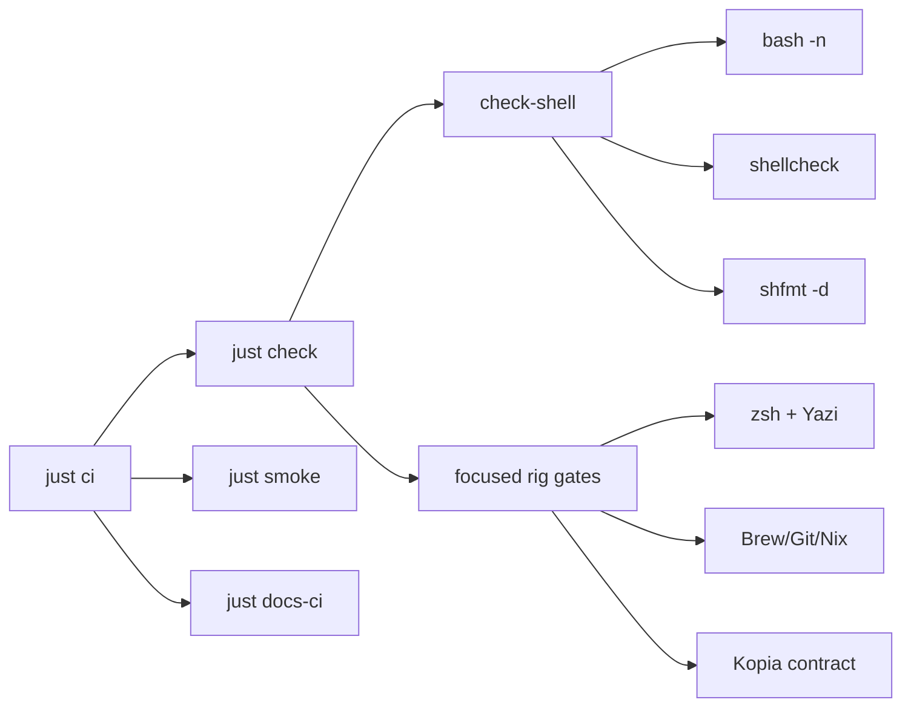

```bash
just check          # aggregate static + focused validation suite
just check-shell    # bash -n + shellcheck + shfmt -d
just check-just-fmt # canonical justfile formatting
just check-mise-boundary
just check-rig-ecosystem-assurance
just check-ghostty
just check-yazi-config
just check-kopia-nightly
just check-freshen
just check-apple-text
just check-iina-config
just check-mba-migration-policy
just check-music-ingest
just check-music-likes
just music-hygiene      # read-only library inventory
just music-duplicates   # writes only a review CSV, never audio
just iina-native preview
just iina-shaders preview
just iina-plugins preview
just check-remote-access
just remote-access
just check-bats
just fmt-shell      # shfmt -w (preview: just check-shell)
just smoke          # non-destructive runtime
just ci             # check + smoke + docs-ci
just secrets-scan
just brew-check
just docs-ci
```

| Focused gate | Contract |
| --- | --- |
| `just check-zsh` | zsh syntax/mirror parity, exact plugin/history/load ordering, tracked pnpm completion, `fkill` PID safety, activation-only `layout_uv` fixtures, and Darwin `compaudit` |
| `just check-rig-ecosystem-assurance` | Agent Deck/tmux ownership, nbdime provider and Git wiring, no unapproved `dft`/difftastic wiring, and no G4 macOS defaults |
| `just check-ghostty` | Ghostty template/data/zsh/docs contracts plus isolated Chezmoi rendering and native parsing when Ghostty and Chezmoi are available; never applies config |
| `just check-yazi-config` | Current fields, resolved plugin/flavor locks, dark/light theme mapping, Option DuckDB keys, and isolated native parsing when Yazi is available |
| `just check-kopia-nightly` | Static runner/plist contract (cap in the runner, no launchd `TimeOut`; no live `kopia` / launchd) |
| `just check-freshen` | Version SSOT, privacy/goldens, `zsh -n`, and `tests/freshen_test.zsh` (no live Homebrew/mas mutations) |
| `just check-apple-text` | Canonical Text Replacement / Shortcuts registries plus offline merge harness (no Apple DB writes) |
| `just check-iina-config` | Native IINA profile, shader/pin parity, retired QoL source and destination ignores (no live writes) |
| `just check-mba-migration-policy` | Nine synthetic suites: v2/v3 APFS budgets, retained-root inventory, review-only offload manifests, media policy/census/stage/reader fixtures, assertion-only receipt joins and simulated resource leases; no live host, backup, authorization or cross-host coordinator proof |
| `just check-music-ingest` / `just check-music-likes` | File-only music runner, LaunchAgent, pin, secret-boundary and workflow contracts; likes also tests playlist fallback/atomic publication with a synthetic library |
| `just iina-native` | Preview-only by default; separate `apply --apply` migrates named QoL paths after explicit review and backup |
| `just iina-shaders` | Preview optional GPL shader pin; `install --apply` and `restore --apply` are separate live actions |
| `just iina-plugins` | Preview only the three pinned official releases; install/restore require IINA quit and `--apply` |
| `just iina-qol` | Retired runner; apply and automatic legacy restore are disabled |
| `just check-remote-access` | RustDesk-over-Tailscale source contract; Bats exercises owned launchd overrides and a synthetic reboot, never live launchctl/TCC or MBA control |
| `just remote-access` | Plan / install / enable / doctor / disable / rollback (mutating commands default to dry-run) |
| `just check-spicetify` | Spotify pin + Spicetify apply runner/plist contract (no live Spotify / launchd) |
| `just check-bats` | File-only Bats coverage when Bats is present; required in CI |

The migration receipt suite checks **supplied assertions**, not independently verified host evidence or user permission: even `verified` input yields only `matching_assertions` with `unverified` coverage. The lease suite simulates one global token across two host identities; it does not acquire a real cross-host lock. A crash, unknown owner or expiry alone cannot release a live operation, and a synthetic stop witness cannot prove that a real process stopped. The offload-manifest suite uses disposable synthetic roots only: private metadata output is not an atomic snapshot, backup, content verification, available capacity, reclaimable space, or permission to evict. An `UNKNOWN` after output creation may leave a private incomplete file; the scanner never auto-unlinks an exposed name that another process could replace. Only a complete receipt with a matching SHA-256 identifies a usable review manifest. Any later MBA-local inventory must preserve MCPHub, music services, Things, Draw Things, LM Studio, RustDesk, and their data/dependencies; a manually cleared space estimate still needs a fresh measured capacity and peak-budget check before deployment.



## `just check`

Runs in this order:

| Recipe | What it gates |
| --- | --- |
| `check-hooks` | `pre-commit validate-config` when `pre-commit` is on `PATH` |
| `check-shell` | `bash -n` + `shellcheck` + `shfmt -d` on `shell_files` (required in CI) |
| `check-just-fmt` | `just --unstable --fmt --check` |
| `check-mise-boundary` | no repo-root `mise.toml` / mise `[tasks]` |
| `check-zsh` | `zsh -n`, dots ↔ home `cmp`, `checks/zsh-structure-test.sh`, `zsh-structure.sh`, Atuin init grep, `zsh-home-behavior-test.sh`, Darwin `checks/zsh-compaudit.sh` |
| `check-freshen` | Version SSOT, privacy/goldens, `zsh -n`, and `tests/freshen_test.zsh` (no live Homebrew/mas mutations) |
| `check-json` | `jq empty` on tracked `*.json` |
| `secrets-scan` | obvious secret-shaped values in tracked source |
| `brew-exclude` | Brewfile vs `rig/brew/exclude.txt` (no Homebrew required) |
| `check-rig-ecosystem-assurance` | Agent Deck/tmux ownership, nbdime, no unapproved `dft` wiring |
| `check-ghostty` | Ghostty source contract plus optional isolated rendered parse; no home config writes |
| `check-yazi-config` | fields, locks, flavors, keys, isolated parse |
| `check-stale-paths` | freeze on pre-`rig/` machine path contracts |
| `check-kopia-nightly` | headless Kopia runner contract (no live `kopia` / launchd) |
| `check-apple-text` | Text Replacement registries + offline merge (no `TextReplacements.db`) |
| `check-iina-config` | Native IINA profile, shader refs, optional installer pins and QoL-source retirement (no live mutation) |
| `check-mba-migration-policy` | Nine synthetic suites: v2/v3 budget, retained-root inventory, private review-only offload manifest, global media policy, local-only census, fixture stage journal, reader guard, receipt assertion joins and lease simulation; no live host/media operation or distributed enforcement |
| `check-music-ingest` / `check-music-likes` | Static source/recipe/bootstrap contracts plus synthetic likes-playlist safety; no live music mutation |
| `check-remote-access` | RustDesk-over-Tailscale runner contract (no live launchctl / TCC) |
| `check-spicetify` | Spotify pin + Spicetify apply runner contract (no live Spotify / launchd) |
| `check-bats` | `checks/*.bats` when Bats is present; required in CI |
| `check-chezmoi-ignore` | `.chezmoiignore` uses destination/target names |
| `check-darwin-lock` | `flake.lock` JSON + recoverable nix-darwin pin |
| `check-linux-dev-env-rc` | Linux `run_dev_env` exit-status capture (no `$HOME` mutation) |
| `check-shell-files` | justfile `shell_files` matches tracked `*.sh` + named home runners (untracked new IINA/music files stay a tracking-only blocker until reviewed for Git) |

## Docs / hooks (not inside `just check`)

| Recipe | Role |
| --- | --- |
| `docs-install` | `pnpm install` in `docs/` |
| `docs-check` | typecheck when `docs/node_modules` exists |
| `docs-build` | Fumadocs/Next static build |
| `docs-sensitive` | PII / token-shaped patterns in docs |
| `docs-hub-parity` | `hub-manifest.json` slugs ↔ sidebar `meta.json` |
| `docs-ci` | frozen install + typecheck + build + CSS health + sensitive + hub-parity |
| `hooks-install` | install pre-commit + pre-push hooks |
| `hooks-run` | `pre-commit run --all-files` |
| `hooks-update` | `pre-commit autoupdate` |

`just docs-ci` is what GitHub CI runs for the site (`pnpm install --frozen-lockfile`). Local-only: `just check-zsh-smoke`, `just zsh-time`. Optional when tools exist: `just brew-check`, `just darwin-check`, `just home-diff`.

Full recipe list: `just --list`.
